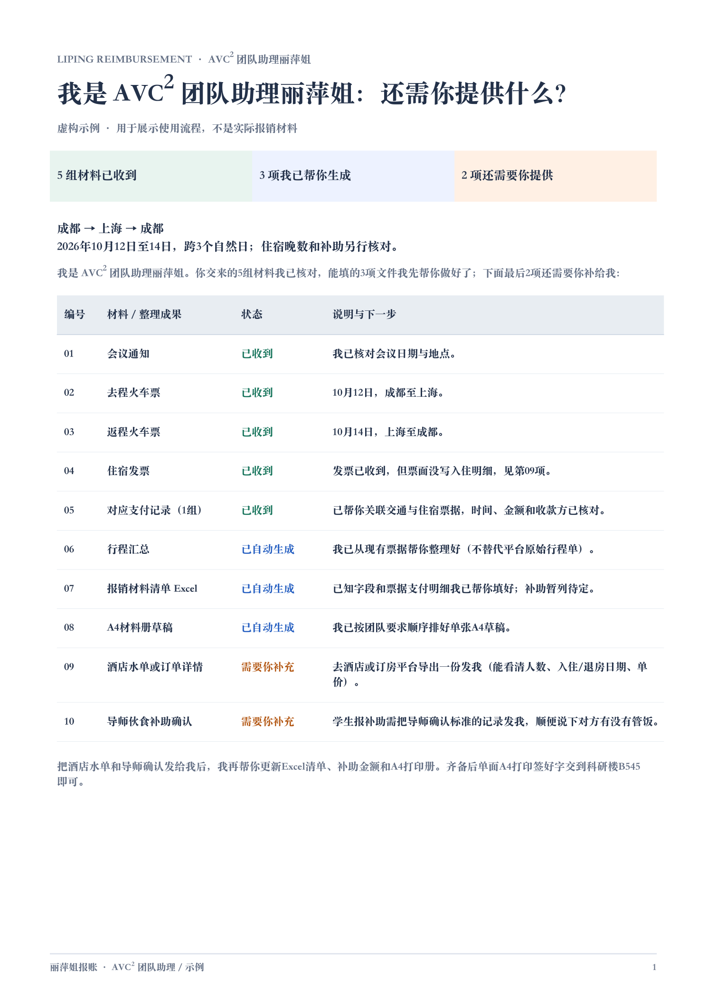

# 丽萍姐报账 (`liping-reimbursement`)

> **“我是 AVC² 团队助理丽萍姐，先把你手头有的行程、车票、发票发给我，能填的表和说明我先帮你弄好，再配图告诉你需要提供什么。”**

`liping-reimbursement`（**丽萍姐报账**）是为电子科技大学视频通信与智能计算团队（**AVC²**）定制的拟人化差旅报销整理与初审 Skill，兼容 **Codex**、**Antigravity** 与 **Claude Code**。



---

## 核心功能

1. **第一人称「AVC² 团队助理丽萍姐」拟人化初审**
   - 直接把聊天文字、车票 PDF、发票、订单截图或压缩包丢给丽萍姐，无需自己先填大表。
   - 自动从票据中还原出差人、起止日期、城市路线与住宿晚数。
2. **先替你干活，再列「还需要你提供什么」**
   - 自动分成三类清单：**已收到**、**我已帮你生成**、**还需要你提供**。
   - 自动填写 **《附件1 报销材料清单》Excel**（含「票据与支付明细」工作表）。
   - 遇到自驾/租车，自动预填内置的 **《附件2 电子科技大学出差车辆行驶登记表》Word**。
   - 遇到**邀请方承担食宿**，**无需向邀请方索取证明**——报销时不报销对应食宿，由丽萍姐直接自动起草《情况说明》，本人核对签字即可。
3. **缺啥材料直接给你看脱敏样图（内置 17 类真实图例）**
   - 缺酒店水单、缺支付截图、缺会议通知、缺注册费收费标准、缺录用通知时，直接嵌入对应的脱敏样图 + 一两句大白话提示。
   - **贴合实际操作口径**：支付平台账单截图显示收款方简称或星号（如 `北京**服`）直接照收，绝不死板要求展开全称。
4. **一键生成单张 A4 打印册 PDF**
   - 自动按团队规定顺序（**会议通知 → 交通票据 → 住宿票据 → 其他票据 → 支付记录**）排版为单面 A4 PDF。
   - 超过 200 元发票的支付记录页底部自动标注对应票据编号，不遮挡原图信息。

---

## 快速安装

### 方式一：一键脚本安装（Codex / Antigravity / Claude Code 通用）

```bash
git clone https://github.com/wqytommy666/liping-reimbursement.git
mkdir -p ~/.codex/skills ~/.agents/skills ~/.gemini/config/skills
cp -R liping-reimbursement/skills/liping-reimbursement ~/.agents/skills/liping-reimbursement
ln -sfn ~/.agents/skills/liping-reimbursement ~/.codex/skills/liping-reimbursement
ln -sfn ~/.agents/skills/liping-reimbursement ~/.gemini/config/skills/liping-reimbursement
```

### 方式二：下载 Release 压缩包安装

从 [Releases](https://github.com/wqytommy666/liping-reimbursement/releases) 下载 `liping-reimbursement.zip`，解压到你的技能目录（如 `~/.codex/skills/` 或 `~/.gemini/config/skills/`）。

---

## 怎么找丽萍姐报账？

安装后直接在对话框里把材料路径或文件发出来即可：

```text
丽萍姐，帮我报销这次差旅，行程和现有票据都在这个文件夹里，你先帮我整理好，再告诉我还差什么需要提供。
```

或者显式调用 Skill：

```text
使用 $liping-reimbursement 帮我整理这次差旅报销材料，看看还需要我提供什么。
```

---

## 内置材料图例一览（共 17 页）

完整 PDF 手册见 [`docs/丽萍报账-材料图例手册.pdf`](docs/丽萍报账-材料图例手册.pdf)：

| 序号 | 材料类型 | 图例文件 | 丽萍姐的审核口径 |
| :---: | --- | --- | --- |
| 01 | 支付记录 | `payment-record.png` | 单张发票 >200 元需附支付时间、金额、收款方；平台简称照收 |
| 02 | 支付与退款记录 | `refund-payment.png` | 合并支付或退票需附支付与退款截图，并注明对应票据 |
| 03 | 酒店水单 / 住宿明细 | `hotel-detail.png` | 发票未写明入住/退房日期、单价、天数时，向酒店或平台索取水单 |
| 04 | 住宿费发票 | `hotel-invoice.png` | 抬头：电子科技大学（税号 `121000004507193117`） |
| 05 | 火车票 / 铁路电子客票 | `rail-ticket.png` | 需能看清乘车日期、起讫站、乘车人和票价 |
| 06 | 机票款发票 | `airfare-invoice.png` | 票面行程信息不全时需附平台或航司行程单 |
| 07 | 退票手续费发票 | `refund-fee-invoice.png` | 附退票手续费发票及对应退票记录 |
| 08 | 网约车 / 出租车行程单 | `taxi-itinerary.png` | 从出行平台导出，需有每段时间、起终点和费用 |
| 09 | 网约车 / 出租车发票 | `taxi-invoice.png` | 与网约车行程单对应 |
| 10 | 会议注册费发票 | `conference-fee-invoice.png` | 报销注册费时需同时附会议通知和注册费收费标准 |
| 11 | 行程变更情况说明 | `itinerary-change-note.png` | 由丽萍姐按真实行程自动起草，本人核对签名 |
| 12 | 会议通知 / 邀请函 | `conference-notice.png` | 含会议时间、地点和主办方 |
| 13 | 会议注册费收费标准 | `conference-fee-standard.png` | 国内/国际会议收费标准页，需能看清对应代表类别的金额 |
| 14 | 论文录用通知 | `paper-acceptance-notice.png` | 因论文录用参会或报销时提供，含论文题目与录用结论 |
| 15 | 出差车辆行驶登记表（附件2） | `vehicle-registration-form.png` | 自驾/租车必填（已内置 Word 模板），自驾/租车不发市内交通费 |
| 16 | 邀请方承担食宿情况说明 | `host-covered-lodging-note.png` | **不用对方开证明**，报销时不报销食宿，由丽萍姐直接写说明、本人签字 |
| 17 | 其余按需补充事项 | `no-source-examples.png` | 导师/经费项目确认、实际收款方不一致盖章说明、航司行程单等 |

---

## 仓库目录结构

```text
liping-reimbursement/
├── README.md
├── LICENSE
├── docs/
│   ├── 丽萍报账-清单示例.png
│   ├── 丽萍报账-清单示例.pdf
│   └── 丽萍报账-材料图例手册.pdf
└── skills/
    └── liping-reimbursement/
        ├── SKILL.md
        ├── agents/
        │   └── openai.yaml
        ├── assets/
        │   ├── 差旅报销通知-2026-10-28.pdf
        │   ├── 附件1-报销材料清单.xlsx
        │   ├── 附件2-电子科技大学出差车辆行驶登记表.docx
        │   ├── example.json
        │   └── material-examples/
        │       ├── catalog.json
        │       └── *.png
        ├── references/
        │   ├── example.md
        │   ├── material-examples.md
        │   ├── packet.md
        │   ├── policy.md
        │   └── template-map.md
        └── scripts/
            ├── build_packet.py
            └── test_build_packet.py
```

## 许可证

MIT License，详见 [LICENSE](LICENSE)。
